<div align="center">


# Hunty

**Свой мессенджер для своих.**<br>
Чат, голос, вебки и показ экрана напрямую между друзьями — без серверов, регистрации и паролей.

[](https://github.com/sklayxxx/hunty/releases/latest)
[](https://github.com/sklayxxx/hunty/releases)
[](#скачать)

**[Скачать](https://github.com/sklayxxx/hunty/releases/latest)** · [Как пользоваться](docs/GUIDE.md) · [Что нового](CHANGELOG.md)

</div>

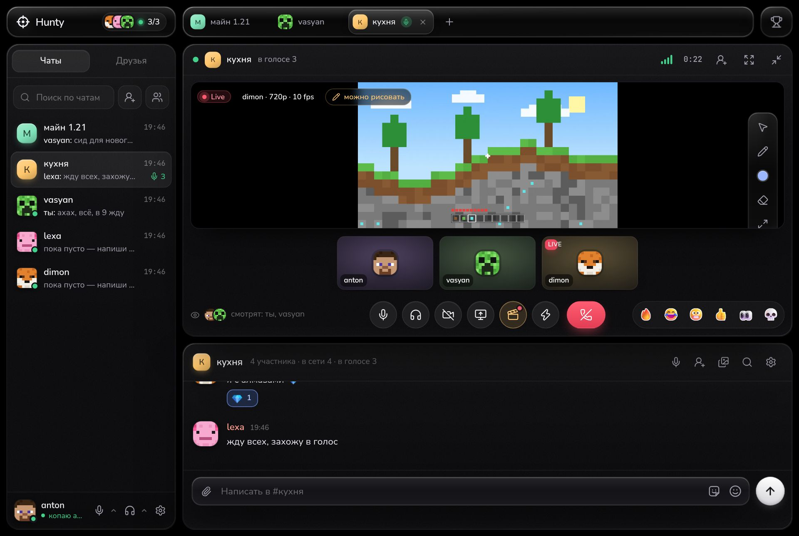

- **Серверов нет.** Друзья соединяются друг с другом напрямую, переписка лежит только у участников чата.
- **Регистрации нет.** Ник, моб на аватарку — и всё. Акк — это ключ, который создаётся у тебя на компе.
- **Бесплатно навсегда.** Платить не за что: у Hunty нет своих серверов.

## Скачать

| Система | Файл | Что это |
|---|---|---|
| **Windows 10/11** | [`Hunty_…_x64-setup.exe`](https://github.com/sklayxxx/hunty/releases/latest) | установщик, права админа не нужны |
| | [`Hunty-portable.exe`](https://github.com/sklayxxx/hunty/releases/latest/download/Hunty-portable.exe) | один файл, без установки |
| **Linux** (x86_64) | [`hunty-linux-x64.tar.gz`](https://github.com/sklayxxx/hunty/releases/latest/download/hunty-linux-x64.tar.gz) | интерфейс открывается в браузере |
| **macOS** | — | пока только из исходников, см. [docs/DEV.md](docs/DEV.md) |

**Windows.** Exe без платной подписи, поэтому при первом запуске SmartScreen может написать «Windows защитил ваш компьютер» →
**Подробнее → Выполнить в любом случае**. Когда Windows спросит про доступ к сети, разреши для **частных сетей**, иначе друзья в локалке не увидят друг друга.
Новые версии Hunty предложит сам и обновится в один клик, история и друзья останутся.

**Linux:**

```sh
tar xzf hunty-linux-x64.tar.gz
./hunty/hunty                         # запустить — откроется в браузере
./hunty/hunty --install               # поставить в ~/.local/bin + ярлык «Hunty» в меню приложений
./hunty/hunty --install --autostart   # …и запускать в фоне при входе в систему
```

Работает в Chrome, Chromium, Brave, Edge и Firefox (`http://127.0.0.1:7457`). Сеть общая: друзья на Windows и на Linux видят друг друга,
группы и звонки общие. Подробнее — [docs/README-linux.txt](docs/README-linux.txt) (он же `README.txt` в архиве).

<details>
<summary>Почему на Linux через браузер, а не просто сайт?</summary>

Браузер сам не может быть P2P-узлом: ему нельзя открывать TCP/UDP-порты, ходить в DHT и пробивать NAT. «Чистому сайту» понадобился бы
сервер-посредник, и он видел бы, кто с кем общается. Поэтому на Linux работает маленькое локальное ядро, а интерфейс тот же, что в exe.
Наружу ядро не торчит: слушает только `127.0.0.1`, чужие сайты к нему не подключатся.

</details>

## Как начать

1. **Запусти Hunty и придумай ник**: латиница, цифры, `.` `_` `-`. Моба на аватарку выдаст система (не нравится — «Крутить ещё»), свою картинку можно поставить потом.
2. **Сохрани резервную копию**: Настройки → Акк → Резервная копия → **Сохранить файл**. Пароля нет, акк — это ключ на компе, и без этого файла его не вернуть после переустановки.
3. **Добавь друга**: вкладка «Друзья» → **Добавить друга** → его ник или код `hunty://add/…`. Свой код копирует кнопка «Код» в том же окне. Друг принимает заявку, и вы в друзьях.
4. **Пиши** в личку или собери группу: кнопка «Создать группу» рядом с поиском или «+» во вкладках сверху.
5. **Звони**: в личке — трубка в шапке чата, в группе — **Зайти** в голос. Показать экран — кнопка с монитором внизу звонка.

Всё остальное, по шагам и с картинками, — в **[инструкции](docs/GUIDE.md)**.

## Что умеет

**Переписка**
- личка и группы: ответы, реакции, правка и удаление, пересылка, закреп, @упоминания, «печатает…»;
- разметка: `**жирный**`, `*курсив*`, `~~зачёркнутый~~`, `` `код` ``, `||спойлер||`, цитаты;
- картинки, файлы, превью ссылок и YouTube, стикеры;
- поиск по переписке (Ctrl+F), вкладки чатов как в браузере, «Избранное» — чат с собой;
- история лежит у всех участников и докачивается, когда кто-то появляется в сети.

**Голос и экран**
- звонки в личке и голос в группах до 6 человек, вебки, мини-окно звонка;
- показ экрана или окна до 1440p и 60 FPS со звуком компа — друзья могут рисовать и указывать прямо поверх;
- нейро-шумодав RNNoise, эхоподавление, автогромкость, мастер «Меня плохо слышат», эффекты голоса;
- громкость каждого 0–200% правым кликом по его плитке, «Беречь уши» от резких звуков;
- рация и хоткеи, которые работают в играх (Windows).

**Фишки**
- 🏆 зал славы: лучшие моменты чатов и награды недели;
- клипы последних 30 секунд звонка по F8;
- стикеры из своих фоток: фон убирается сам, белая обводка, глянец или голограмма;
- саундборд, перекличка, голосование и перерыв (F1–F7), эффекты сообщений;
- статус «Играет в…», AFK-мобы и пасхалки.

**Внешний вид**
- чёрный фон или свои обои под «жидким стеклом»;
- 12 шрифтов, размер текста, лёгкий режим для слабых компов;
- аватарка — моб из майнкрафта или своя картинка, цвет ника, шапка профиля.

## Как выглядит

| | |
|:---:|:---:|
| 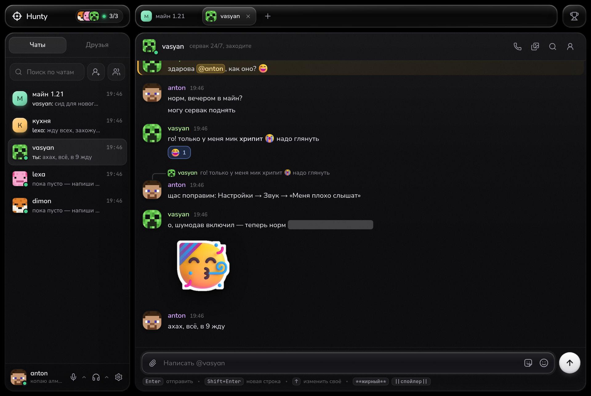<br>Личка: реакции, ответы, спойлеры, стикеры | 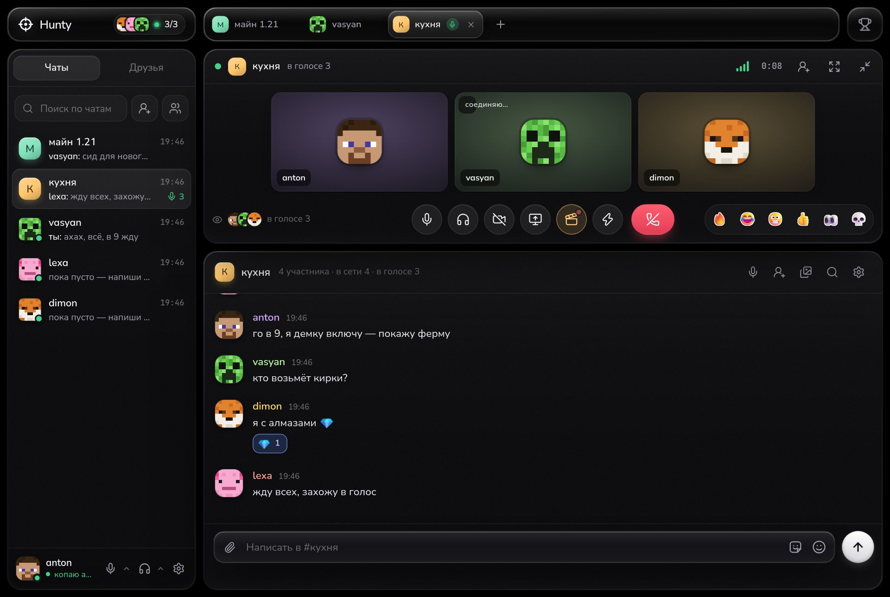<br>Голос в группе |
| 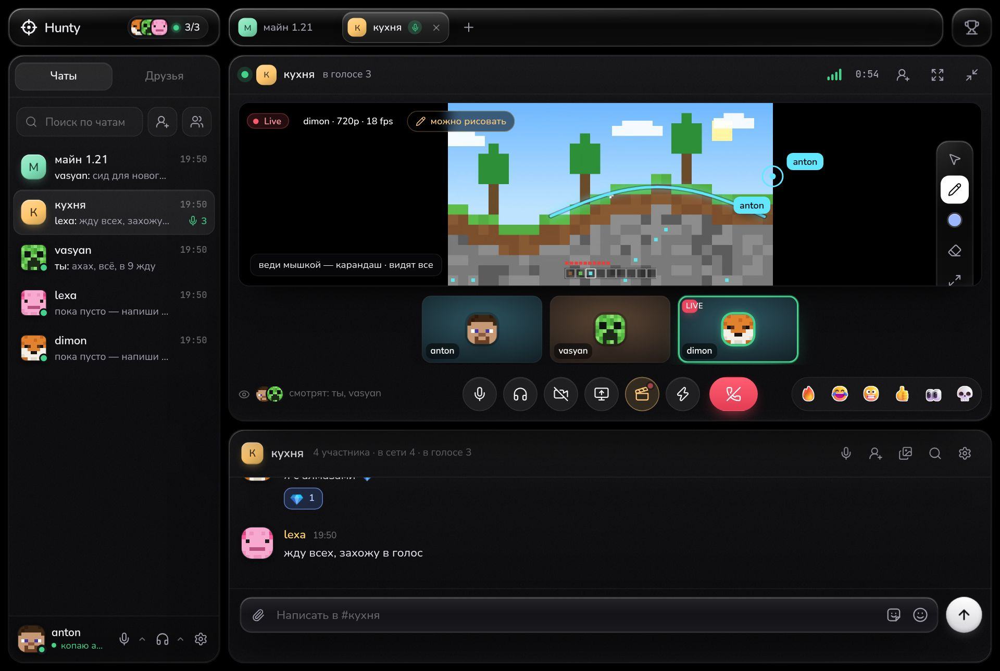<br>Рисуют прямо поверх показа экрана | 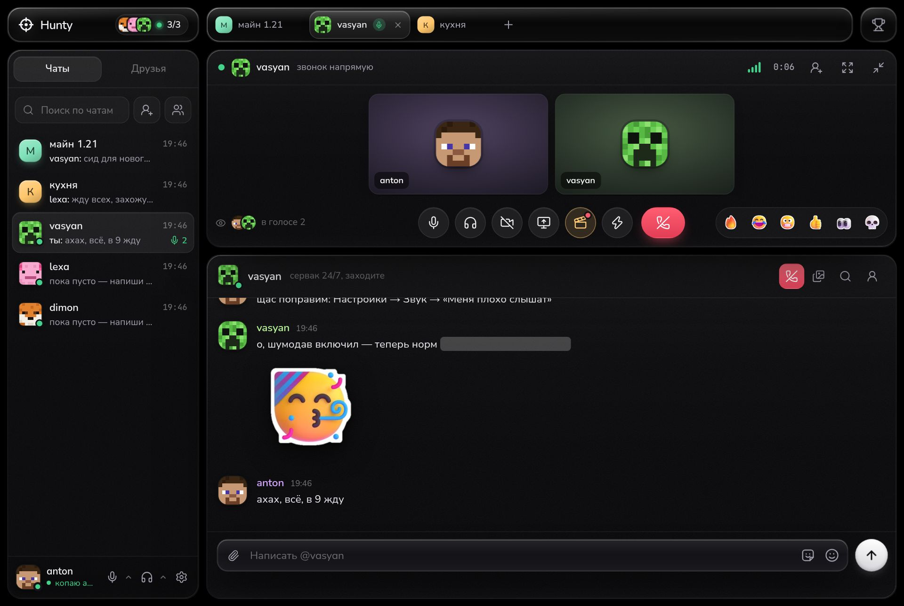<br>Звонок в личке |
| 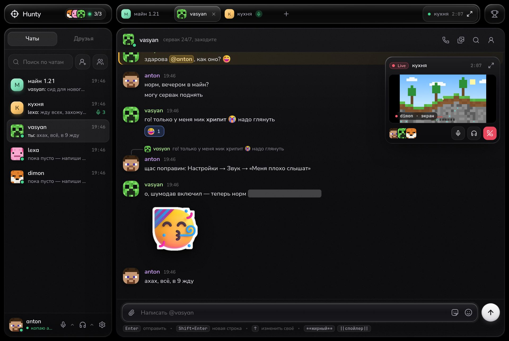<br>Мини-окно: звонок не мешает переписке | 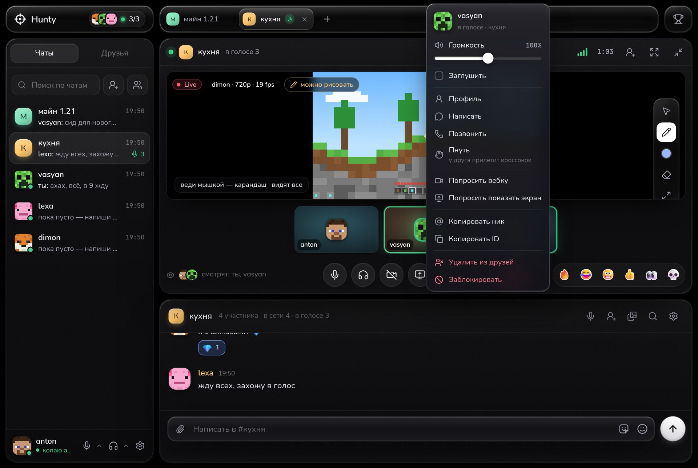<br>Громкость друга — правым кликом |
| 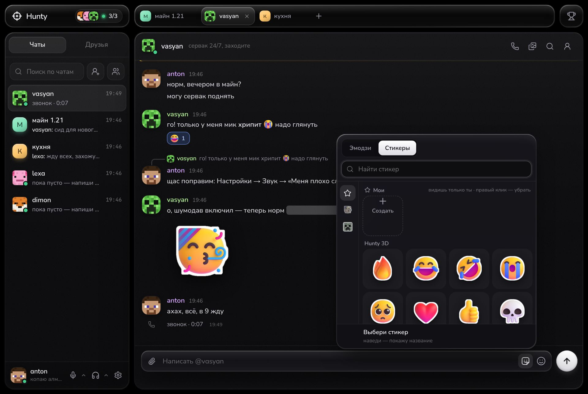<br>Стикеры, в том числе свои | 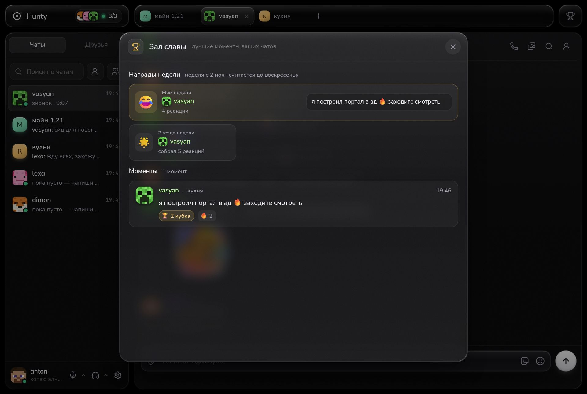<br>Зал славы |
| 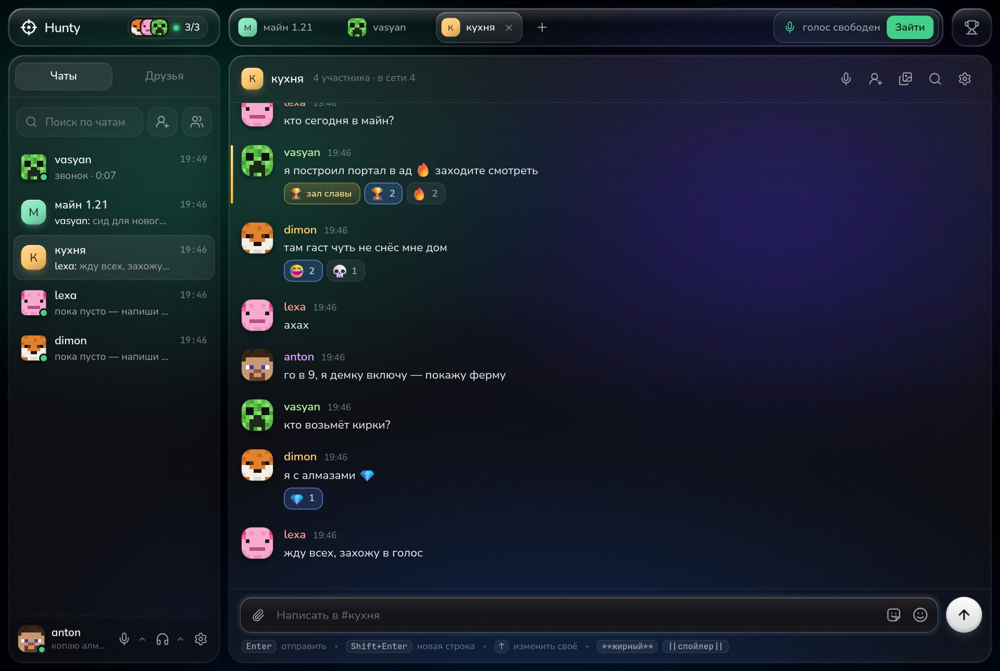<br>Обои под стеклом | 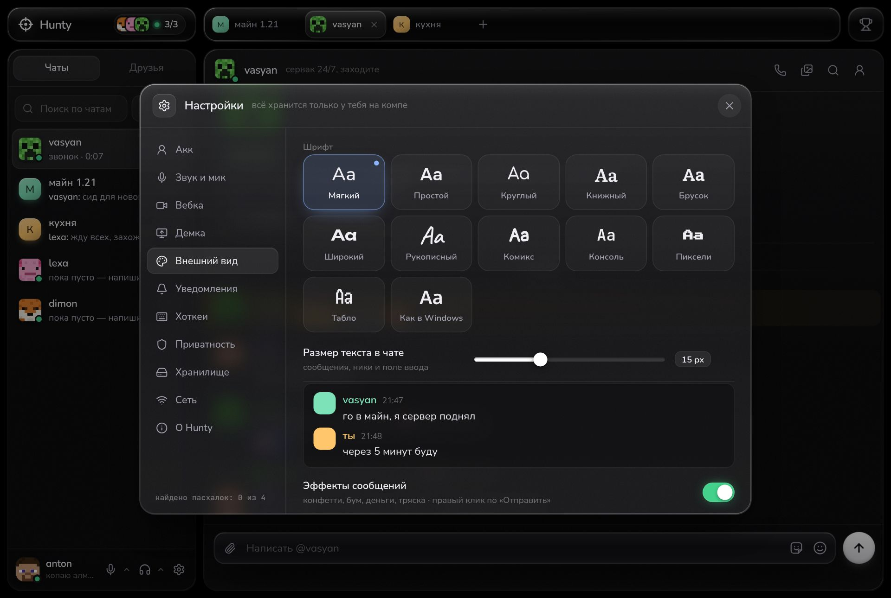<br>12 шрифтов и размер текста |

## Как это устроено

- **Серверов нет.** Каждый Hunty — узел сети [libp2p](https://libp2p.io). Друзья находят друг друга через общих друзей (за доли секунды),
  через публичный IPFS DHT или сами в локалке (mDNS).
- **Связь напрямую.** Hunty сам открывает порт на роутере (UPnP), пробивает NAT (hole punching), а если не вышло, идёт через ретранслятор,
  в том числе через общего друга.
- **Шифрование.** Сообщения и сигналинг звонков шифруются Noise, голос, вебки и экран идут через WebRTC (DTLS-SRTP) напрямую между участниками.
  Каждое сообщение подписано ключом автора (Ed25519), подделать его нельзя.
- **Акк — это ключ** на твоём компе. Ни пароля, ни почты нет, поэтому резервная копия так важна.
- **История** хранится у участников чата. Пока тебя не было, сообщения в группе докачаются у любого, кто в сети.

## Сервер для друзей

Центрального сервера у Hunty нет и не будет, зато каждый комп с Hunty — **мини-сервер для своих**. Когда ты подключаешься к другу,
он рассказывает, где сейчас ваши общие друзья, и сводит вас (обычно за доли секунды). Если у кого-то не пробивается напрямую,
связь идёт через друга-помощника (только для друзей и групп).

Друг с белым IP или UPnP на роутере сам становится «хабом»: к нему стучатся первым, через него знакомятся. Ничего включать не нужно.

Комп, который почти всегда включён, можно сделать **сервером для друзей**:

1. Настройки → Сеть → «Этот комп — сервер для друзей» → перезапусти Hunty.
2. Под переключателем появится статус. «Снаружи порт закрыт» — открой на роутере указанный там порт (**TCP и UDP**) на этот комп или включи UPnP в роутере. С белым IP ничего делать не надо.
3. Держи Hunty запущенным: крестик прячет его в трей. Пока сервер включён, Windows не уходит в сон.

Друзья узнают о сервере сами при следующем подключении.

Это **не** сервер как в Discord, где лежат все сообщения. Он хранит историю только тех групп, где состоит сам (и друзья докачивают её у него,
потому что он всегда в сети). Чужие лички на нём не хранятся. Голос и экран всё равно идут напрямую между участниками: через сервер проходит
только сам вызов.

## Если что-то не так

**Друг не находится по нику.** Поиск по нику идёт через публичный DHT и находит друга, только если он сейчас в сети и у него включено
«Находить меня по нику» (Настройки → Приватность). Сразу после запуска подожди минуту. Надёжнее всего код: друг жмёт «Код» в окне «Добавить друга» и скидывает тебе.

**В локалке не видим друг друга.** Разреши Hunty в брандмауэре Windows для частных сетей. На Linux проверь, что firewall пропускает mDNS (udp 5353).

**В звонке висит «соединяю…» или не слышно друг друга.** Звук идёт напрямую, а у кого-то из вас строгий NAT. Включи UPnP на роутере
или «Открывать порт на роутере» в Настройки → Сеть (там же кнопка «Проверить» покажет, как дела со связью). Не помогло — задай в Сети
постоянный порт и пробрось его на роутере (TCP и UDP).

**Меня плохо слышат, хрипит или шумит.** Стрелка рядом с микрофоном внизу слева → **Меня плохо слышат**: мастер за минуту проверит мик
и сам подберёт настройки. Там же — шумодав, громкость мика и эффекты.

**Друзья слышат эхо или самих себя.** Надень наушники или проверь, что включено «Эхоподавление» (Настройки → Звук и мик).

**Перенести акк на другой комп.** На старом: Настройки → Акк → Резервная копия → **Сохранить файл**. На новом при первом запуске нажми
**Восстановить из файла** (или Настройки → Акк → «Восстановить»). Ключ, ник, друзья и группы переедут, переписку Hunty докачает у друзей.

**Где лежат данные.** Windows — `%APPDATA%\app.hunty`, Linux — `~/.local/share/hunty`: ключ, друзья, история, `hunty.log`.
Файл резервной копии храни как пароль — с ним можно войти в твой акк.

**Как обновиться.** Hunty раз в день сам проверяет новые версии и пишет «Вышел Hunty vX» → **Обновить**. Вручную — Настройки → О Hunty → «Проверить обновления».

**Что-то сломалось.** Настройки → Сеть → «Журнал» → **Копировать** и пришли это в [Issues](https://github.com/sklayxxx/hunty/issues)
вместе с описанием, что делал.

## Ограничения

- **Нет TURN.** Если у обоих строгий (симметричный) NAT, голос и видео напрямую не пробьются, хотя чат будет работать через ретранслятор.
  Помогает UPnP на роутере или проброс порта.
- В голосе до 6 человек: каждый шлёт поток каждому (mesh).
- Сообщение в личке дойдёт, когда вы оба будете в сети (в группе — через любого участника в сети).
- Уникальность ника проверяется по сети, но центрального сервера нет: владельца ника, который давно не заходил, можно не увидеть.
  Люди всё равно различаются по ключу (он виден в профиле).
- Хоткеи в играх и статус «Играет в…» — только в приложении для Windows.
- На Linux нет значка в трее, а уведомления, микрофон и экран — через браузер (он спросит разрешение).
- Exe не подписан: SmartScreen ругается при первом запуске.

## Для разработчиков

Как устроен код, как собрать у себя, запустить тесты и выпустить релиз — в [docs/DEV.md](docs/DEV.md).

## Благодарности

- Дизайн-проход 0.5 — по мотивам [unslop](https://github.com/heydamir/unslop) Damir Sokolovsky (@heydamir), CC BY 4.0.
- Эмодзи — Microsoft Fluent Emoji (MIT), звуки — CC0 (список в [docs/SOUNDS.md](docs/SOUNDS.md)),
  шрифты — OFL 1.1 / Apache 2.0 ([ui/fonts/LICENSE.md](ui/fonts/LICENSE.md)), иконки — Lucide (ISC).
