# Как пользоваться Hunty

Hunty — мессенджер для своей компании: переписка, голос, вебки и показ экрана идут напрямую между друзьями, без серверов.
Здесь всё по порядку, с картинками. Коротко о проекте и ссылки на скачивание — в [README](../README.md).

- [Установка](#установка)
- [Первый запуск](#первый-запуск)
- [Друзья](#друзья)
- [Переписка](#переписка)
- [Группы](#группы)
- [Звонки и голос](#звонки-и-голос)
- [Показ экрана и рисование](#показ-экрана-и-рисование)
- [Клипы, кнопки и звуки](#клипы-кнопки-и-звуки)
- [Зал славы](#зал-славы)
- [Профиль и статус](#профиль-и-статус)
- [Хоткеи](#хоткеи)
- [Настройки](#настройки)
- [Трей, обновления, перенос акка](#трей-обновления-перенос-акка)
- [Если что-то не так](#если-что-то-не-так)

## Установка

**Windows 10/11.** Скачай со страницы [Releases](https://github.com/sklayxxx/hunty/releases/latest) установщик `Hunty_…_x64-setup.exe`
(права админа не нужны) или `Hunty-portable.exe` (один файл, просто запустить).

- SmartScreen пишет «Windows защитил ваш компьютер» → **Подробнее → Выполнить в любом случае**. Так бывает со всеми программами без платной подписи.
- Брандмауэр спрашивает про доступ к сети → разреши для **частных сетей**, иначе друзья в одной локалке не найдут друг друга.

**Linux.** Скачай `hunty-linux-x64.tar.gz`, распакуй и запусти `./hunty/hunty` — интерфейс откроется в браузере.
`./hunty/hunty --install` поставит Hunty в меню приложений, `--install --autostart` ещё и включит автозапуск в фоне.
Все флаги — `hunty --help`, подробности — [README-linux.txt](README-linux.txt).

## Первый запуск

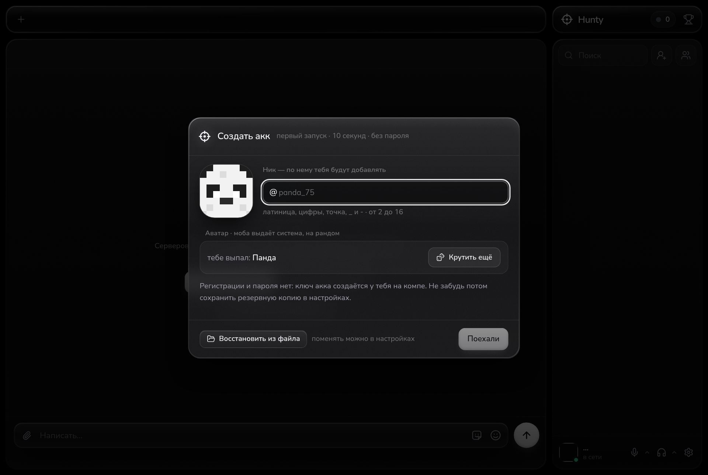

1. **Ник** — по нему тебя будут добавлять. Латиница, цифры, точка, `_` и `-`, от 2 до 16 символов. Большие буквы станут маленькими.
2. **Аватар** — моба выдаёт система. Не нравится — «Крутить ещё». Свою картинку поставишь потом в настройках.
3. **Поехали** — и всё. Регистрации и пароля нет: ключ акка создаётся у тебя на компе.

> [!IMPORTANT]
> Сразу сохрани резервную копию: **Настройки → Акк → Резервная копия → Сохранить файл**. Без этого файла акк не вернуть
> после переустановки Windows или на новом компе. Храни его как пароль: с ним можно войти в твой акк.

Уже есть акк? Нажми **Восстановить из файла** и выбери файл резервной копии.

## Друзья

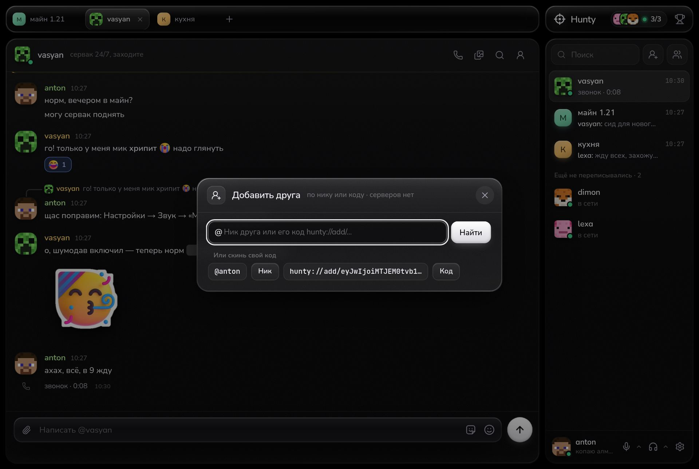

Справа — **один список**: друзья, лички и группы вместе, сверху свежие (удобнее слева — Настройки → Внешний вид → «Список друзей»). Клик по другу — открывается чат с ним. С кем ещё не переписывался,
те собраны в блоке «Ещё не переписывались»: клик — и в пустом чате можно сразу помахать стикером, позвонить или открыть профиль.
Счётчик рядом с логотипом Hunty (аватарки и «3/5») — кто из друзей сейчас в сети; клик по нику в его меню открывает личку.

**Добавить друга** — кнопка с человечком и плюсом рядом с поиском. Впиши:

- **ник** (`vasyan` или `@vasyan`) — Hunty поищет его в сети. Найдёт, только если друг сейчас в сети;
- или **код** `hunty://add/…` — работает всегда, даже если ник не находится.

Свой код и ник копируют кнопки **Код** и **Ник** внизу того же окна — скинь их другу любым способом. Если вы в одной локалке, друг появится
в блоке «Рядом, в локалке» сам.

Друг получит заявку и примет её (✓) или отклонит (✕). Входящие заявки видны в окне «Добавить друга» и в самом верху списка.

**Правый клик по другу** (в списке, в чате или в голосе): профиль, «Написать», «Позвонить», «Пнуть» (у друга прилетит кроссовок 🙂),
попросить вебку или показ экрана, громкость и «Заглушить», копировать ник или ID, «Удалить из друзей», «Заблокировать».
Заблокированный не сможет писать тебе в лс, звонить и слать заявки.

## Переписка

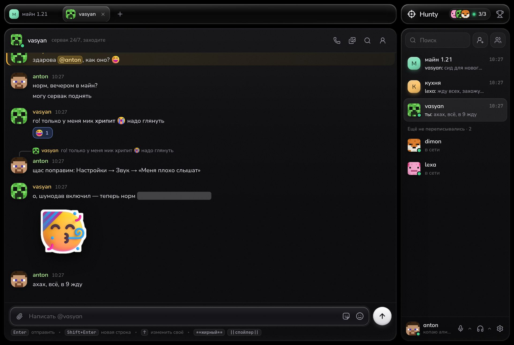

Открытые чаты живут во **вкладках** сверху, как в браузере: перетаскиваются, закрываются крестиком, средней кнопкой мыши или Ctrl+W.
Alt+1…9 — переключиться, Ctrl+Tab — следующая вкладка, Ctrl+Shift+T — вернуть закрытую. Правый клик по вкладке или чату → «Закрепить чат».

**Писать:**

- **Enter** — отправить, **Shift+Enter** — новая строка.
- **↑** в пустом поле — поправить своё последнее сообщение. Править можно 30 секунд после отправки, дальше — только удалить.
- **@ник** — упомянуть (Tab дополняет ник). Упомянутому придёт уведомление, даже если у него включено «Только упоминания».
- **Правый клик по кнопке «Отправить»** — отправить с эффектом: конфетти, бум, деньги, тряска.

**Разметка:**

| Пишешь | Получаешь |
|---|---|
| `**жирный**` или Ctrl+B | **жирный** |
| `*курсив*` или Ctrl+I | *курсив* |
| `__подчёркнутый__` или Ctrl+U | <ins>подчёркнутый</ins> |
| `~~зачёркнутый~~` | ~~зачёркнутый~~ |
| `` `код` ``, блок кода — между строками ```` ``` ```` | `код` |
| `\|\|спойлер\|\|` | спойлер, откроется по клику |
| `> цитата` | цитата |

**Картинки и файлы** — скрепка слева от поля, перетащить в чат или вставить Ctrl+V. Файлы до 6 МБ.
Ссылки на картинки и YouTube показываются прямо в чате (выключается в Настройки → Приватность).

### Что можно сделать с сообщением

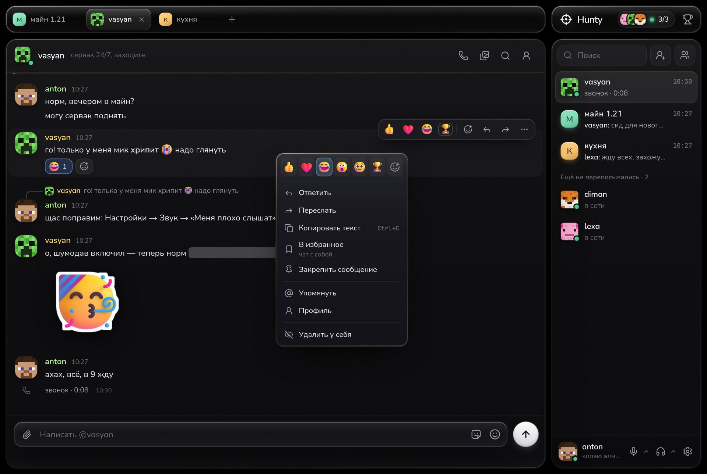

Наведи на сообщение — появятся быстрые реакции и кнопки. **Правый клик** открывает всё меню: реакции, «Ответить», «Переслать»,
«Копировать текст», «Редактировать», «В избранное», «Закрепить сообщение» (в личке или если ты админ группы), «Упомянуть», «Профиль»,
«Удалить у себя» и «Удалить у всех». У картинок ещё «Открыть», «Сохранить», «Копировать» и «Сделать стикер».

**Поиск**: Ctrl+F — по переписке в открытом чате, Ctrl+K — по чатам.

**Избранное** — чат с собой, как «Сохранённые» в Telegram: видишь только ты. Открыть — клик по своему нику под списком друзей → «Избранное».

### Стикеры

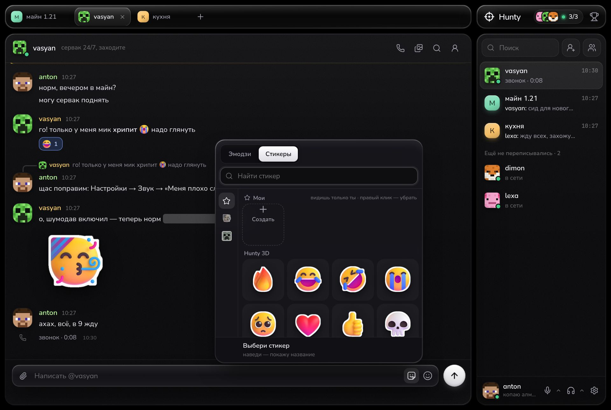

Кнопка со стикером справа в поле ввода открывает пикер: вкладки «Эмодзи» и «Стикеры». В стикерах есть готовые наборы и **твои**.

**Свой стикер из фотки:** в пикере «Создать» (или правый клик по картинке в чате → «Сделать стикер»). Hunty сам вырежет фон, кистью можно
обвести или стереть лишнее. Дальше выбери обводку (нет, тонкая, жирная), покрытие (обычное, глянец, голограмма — блик бежит по стикеру
и у друзей) и подпись, чтобы найти поиском. «Себе» — сохранить, «Отправить» — сразу в чат. Друзьям ничего ставить не надо: стикер уходит картинкой.

Понравился чужой стикер — правый клик → **В мои стикеры**.

## Группы

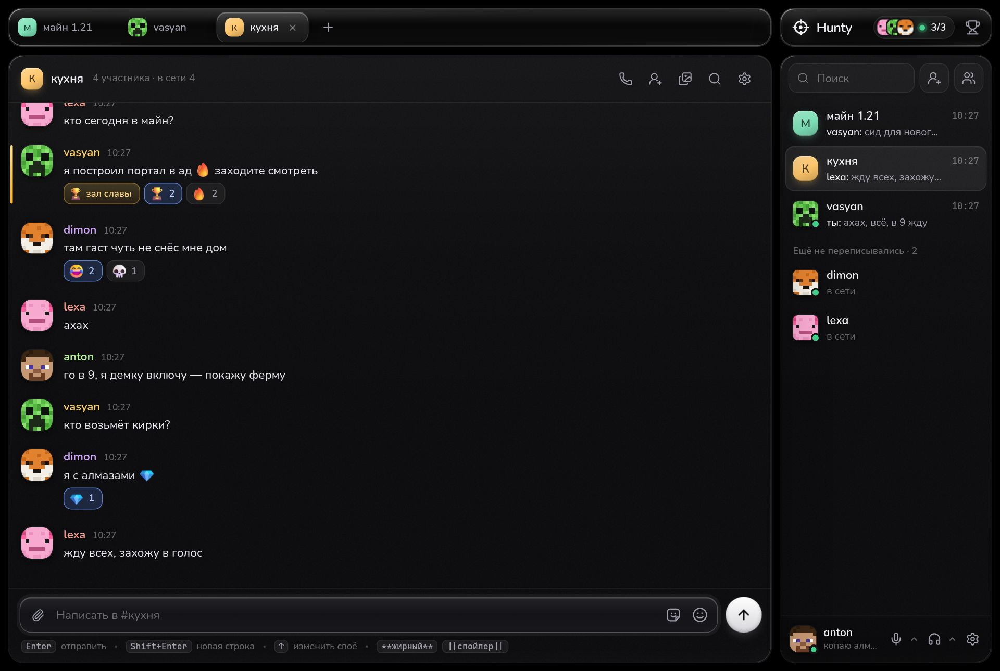

Группа — общий чат и голос для компании. Позвать можно друзей сразу при создании, а по ссылке-инвайту — кого угодно.

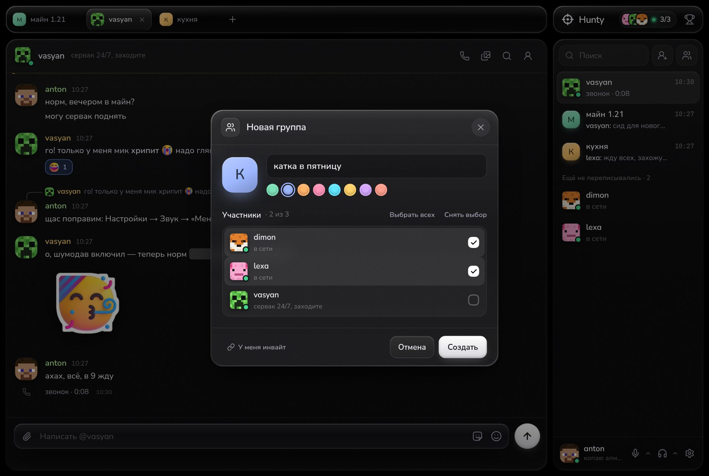

**Создать группу** — иконка с человечками рядом с поиском или «+» во вкладках сверху. Название, цвет, картинка (клик по плитке)
и кого позвать из друзей (есть «Выбрать всех»). Создатель группы — админ. Кто может звать новых, меняется потом в настройках группы.

**Позвать по ссылке** — кнопка «Пригласить» (человечек с плюсом) в шапке группы или шестерёнка → вкладка **Приглашение**: ссылка `hunty://join/…` и QR-код.
Ссылка работает, пока её не сбросишь кнопкой «Сбросить ссылку».

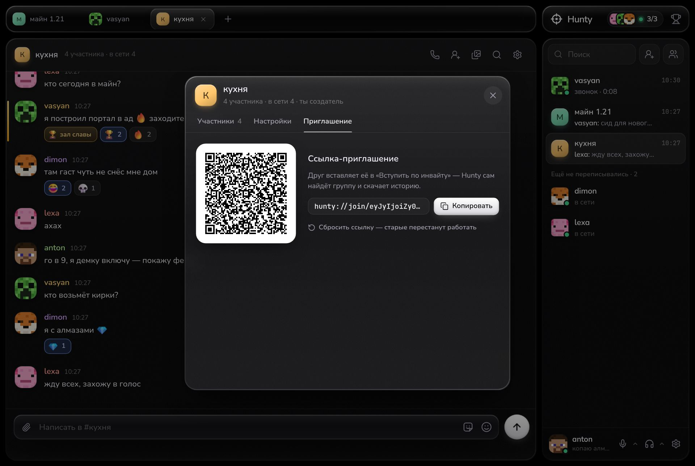

**Вступить по инвайту** — в окне «Новая группа» кнопка «У меня инвайт» (или «Вступить по инвайту» на пустом экране) → вставь ссылку → **Вступить**.
Hunty сам найдёт участников группы и скачает историю. Серверов нет, поэтому кто-то из группы в этот момент должен быть в сети.

**Настройки группы** (шестерёнка в шапке):

- **Участники** — кто в сети, кто админ; «Добавить участников» из друзей; у каждого «⋯» (или правый клик): профиль, написать, громкость,
  сделать или снять админа, выгнать (ссылка-инвайт при этом сбросится, чтобы по старой не вернулись);
- **Настройки** — название, цвет, картинка, «Голосовой канал» (выключи, если группа только для переписки), кто может приглашать
  (все или админы), «Без звука», «Выйти из группы». Не админ видит настройки, но менять их не может;
- **Приглашение** — QR-код, ссылка с кнопкой «Копировать» и «Сбросить ссылку».

## Звонки и голос

### Голос в группе

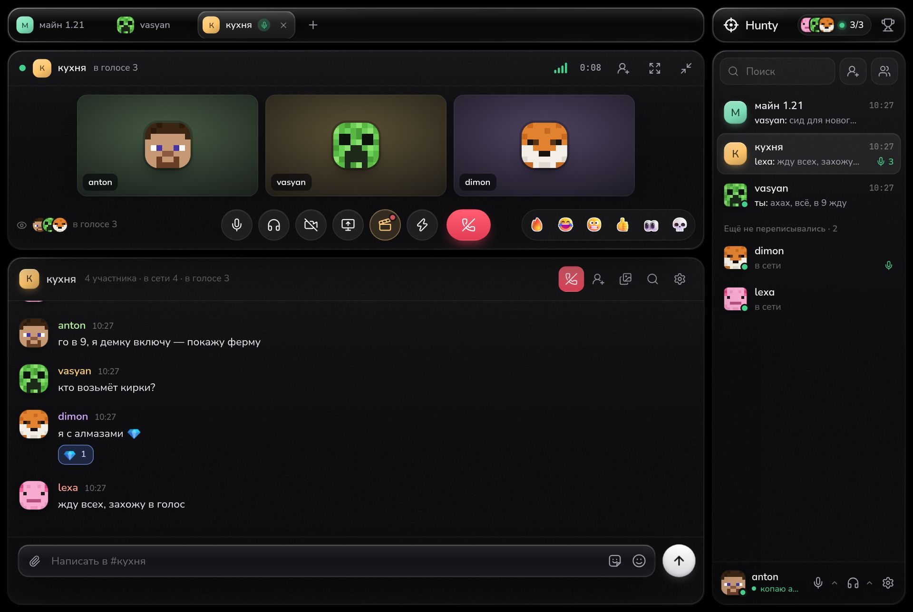

В группе голос всегда открыт: жми **трубку** в шапке группы, справа сверху (цифра на ней — сколько человек уже в голосе). Остальные увидят, что ты в голосе,
и зайдут, когда захотят. В голосе до 6 человек. Выйти — красная трубка там же или красная кнопка внизу звонка, чат при этом остаётся.

Кнопки внизу звонка, слева направо: **микрофон** (Ctrl+M), **звук** (Ctrl+D, никого не слышать — и тебя тоже), **вебка**,
**показать экран** (Ctrl+Shift+S), **клип** (F8), **кнопки и звуки** (F1–F7), **выйти**. Справа — реакции эмодзи, их видят все в голосе.

В шапке звонка: позвать друзей в звонок, «Только звонок — чат спрятать», свернуть в мини-окно, на весь экран.
Значок связи показывает пинг и идёт ли связь напрямую или через ретранслятор.

### Звонок в личке

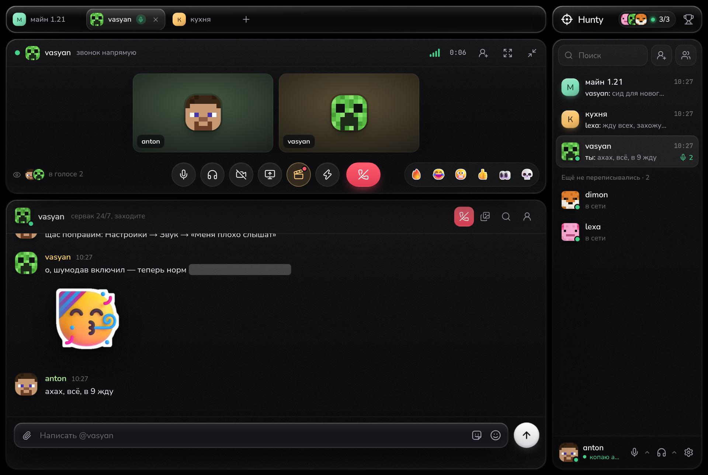

Трубка в шапке лички. У друга всплывёт звонок с кнопками «Ответить» и «Сбросить». Не ответил за полминуты — звонок не сбрасывается:
ты остаёшься в нём и ждёшь, а у друга висит «… в звонке с тобой · Зайти». Позвать в звонок ещё кого-то — кнопка «Добавить друзей в звонок»
в шапке звонка: появится группа, и звонок переедет туда.

### Громкость каждого

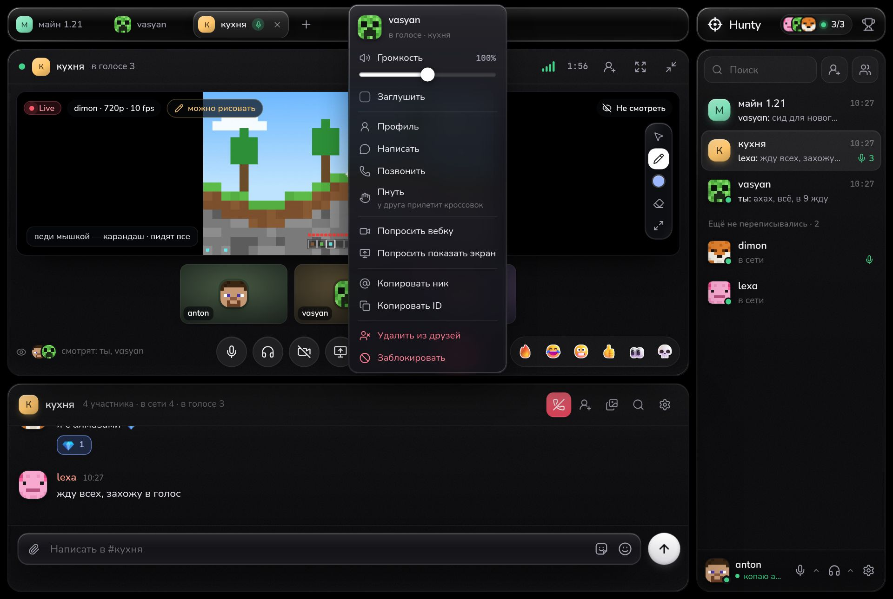

Правый клик по плитке человека в звонке (или по нику в списке голоса) → ползунок **Громкость** 0–200% и **Заглушить** — только у тебя.
Hunty запоминает громкость для человека, в следующих звонках она будет такой же. То же есть в профиле друга.

**Беречь уши** (Настройки → Звук и мик): если у кого-то резко бахнет — крик, взрыв, свист мика, — его на пару секунд приглушит.

### Мини-окно

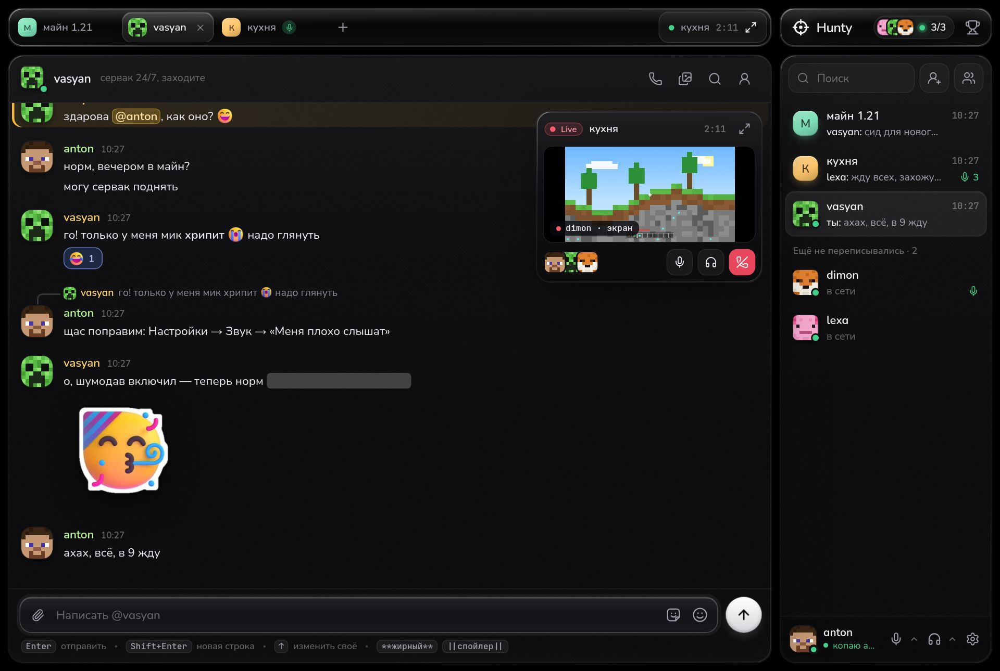

Ушёл из чата группы, а голос продолжается — звонок сворачивается в мини-окно. Его можно таскать за верх, менять размер,
а кнопки мика, звука и выхода всегда под рукой. Вернуться в большой звонок — кнопка в мини-окне или вкладка группы.

## Показ экрана и рисование

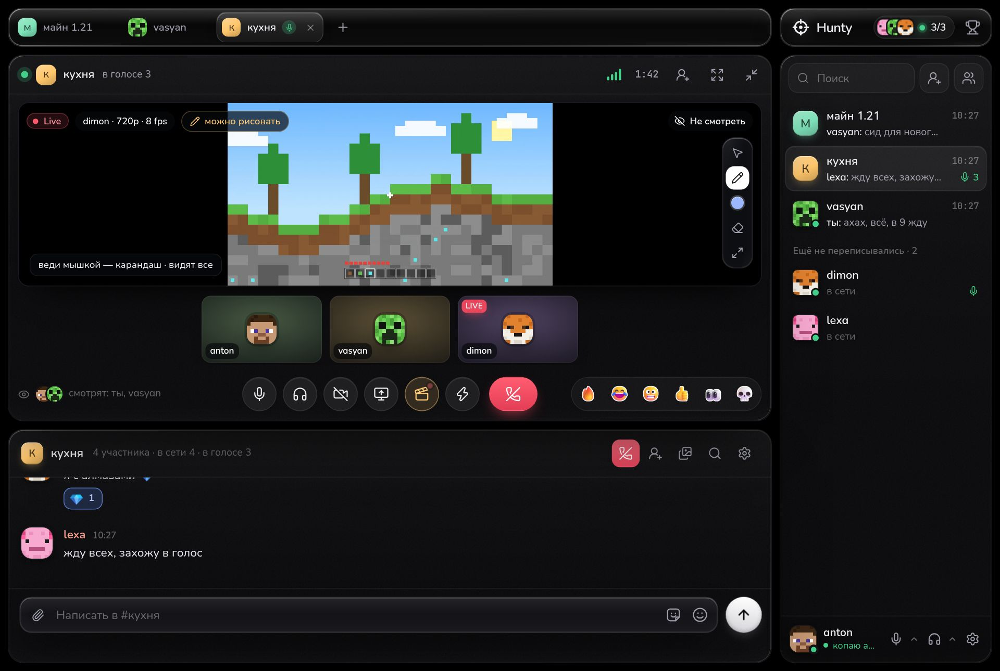

**Показать экран** — кнопка с монитором внизу звонка (Ctrl+Shift+S). В окне выбери:

- **Экран** целиком или одно **Окно**;
- **Качество** 720p, 1080p или 1440p и **FPS** 15, 30 или 60 (качество можно поменять на лету, не останавливая показ);
- **Звук с компа** — друзья услышат игру или видос;
- **Друзья могут рисовать и указывать**.

Жми **Показать** — Windows откроет своё окно выбора экрана (не видно его — нажми Alt+Tab, оно спряталось за Hunty).
Пока идёт показ, сверху горит красная плашка с кнопкой остановки. На ней видно, что **реально** уходит друзьям: сколько человек смотрит,
разрешение, кадры в секунду, кодек и кодирует ли видеокарта. Упёрлось в интернет или процессор — плашка так и скажет.
Кнопка качества на показе (рядом с «Live») меняет 720p/1080p/1440p, 15/30/60 fps и режим «Чёткость текста» или «Плавность» на лету.

Показ получают только те, кто его смотрит: свернул Hunty или нажал **Не смотреть** на чужом показе — твоя копия встаёт на паузу
и не тратит интернет и процессор ни тебе, ни показывающему. «Смотреть» — продолжить.

**Рисовать на чужом экране** — инструменты справа от показа: **указка** (клик — метка на экране у всех), **карандаш**, **цвет пера**
и **ластик** (стирает своё). Метки исчезают сами, через сколько — в Настройки → Демка.

Показывают несколько человек — на показе появятся их аватарки, клик выбирает, чей экран смотреть. Плашка «Live» сверху — кто показывает и в каком качестве.

## Клипы, кнопки и звуки

**Клип** — F8 или кнопка с хлопушкой в звонке. Hunty сохранит последние 30 секунд: с показом экрана — видео, без него — только звук.
Запись хранится только в памяти, пока ты не нажмёшь «клип». Все клипы и картинки чата — кнопка **Клипы и скрины** в шапке чата.
Выключить запись или поменять длину клипа — Настройки → Демка → Клипы.

**Кнопки и звуки** (кнопка ⚡ в звонке):

| Клавиша | Что делает |
|---|---|
| F1 | **Перекличка** — кто тут, отметки на плитках |
| F2 | **Общий сбор** — пуш всем в группе, кто не в голосе |
| F3 | **Перерыв** на 5 минут |
| F7 | **Голосование** — за или против |
| F4 / F5 / F6 | фразы «Эй!», «Заходи» и случайная — скажет голос у каждого |

Там же **саундборд**: звуки, которые слышат все в голосе. Свои (mp3, ogg, wav до 10 секунд) добавляет плитка «Свой звук» —
там же или в Настройки → Звук и мик.

## Зал славы

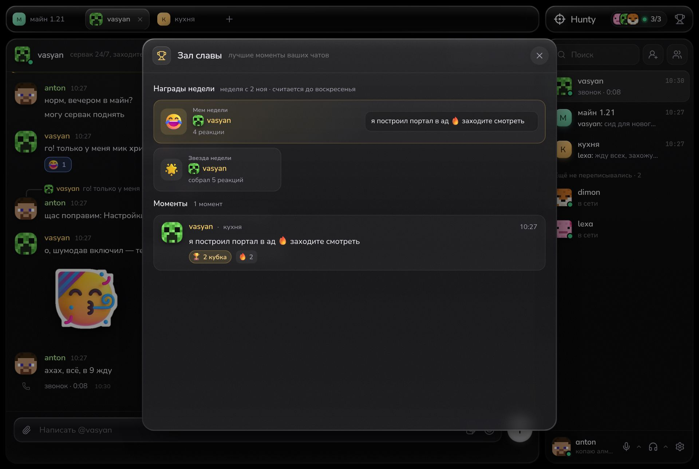

Кубок — в блоке с логотипом, рядом со счётчиком «кто в сети». Сюда попадают лучшие моменты всех чатов:

- 🏆 от других: в личке хватит одной реакции, в группе нужно две;
- или «всем зашло»: в личке 4+ реакций, в группе 5+ реакций от трёх и больше человек.

Свои реакции на своё не считаются. Попало новое — придёт уведомление, а на сообщении появится плашка «зал славы».

**Награды недели**: 😂 Мем недели, 🌟 Звезда недели, 💬 Главный болтун, 🎨 Стикерщик, 🦉 Ночная сова, ❤️ Щедрая душа.

## Профиль и статус

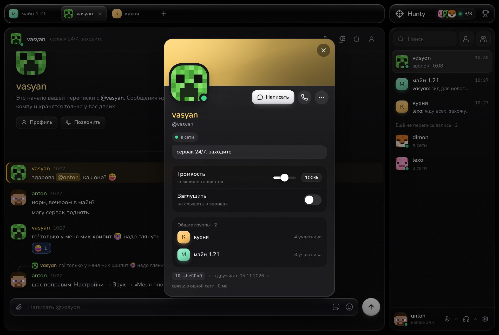

Клик по аватарке или нику — профиль: статус, «О себе», общие группы, громкость и «Заглушить», кнопки «Написать» и «Позвонить».

**Свой статус** — клик по своему нику под списком друзей: «В сети», «Отошёл», «Не беспокоить» (на 30 минут … пока не выключишь),
«Невидимка» (для всех не в сети, но всё работает). Там же строчка статуса («копаю алмазы»), «Мой профиль» и «Избранное».

Свой профиль меняется в Настройки → Акк: аватарка (моб или своя картинка), цвет ника, шапка профиля, статус, «О себе».
Друзья увидят изменения сразу.

## Хоткеи

| Клавиша | Действие |
|---|---|
| Ctrl+M | микрофон вкл/выкл |
| Ctrl+D | звук вкл/выкл |
| V (держать) | рация — включается в Настройки → Звук и мик → Режим мика |
| Ctrl+Shift+S | показать экран / остановить |
| F8 | клип последних 30 секунд |
| F1, F2, F3, F7 | перекличка, общий сбор, перерыв, голосование |
| F4, F5, F6 | фразы |
| Ctrl+K | поиск чата |
| Ctrl+F | поиск по переписке |
| Alt+1…9, Ctrl+Tab | переключить вкладку |
| Ctrl+W, Ctrl+Shift+T | закрыть вкладку, вернуть закрытую |

Любую клавишу можно поменять в Настройки → Хоткеи (для рации подойдёт и боковая кнопка мыши). В приложении для Windows хоткеи звонка работают
и в играх, когда Hunty свёрнут, — это переключатель «Работают в играх». В браузере (Linux) — только пока окно Hunty активно.

## Настройки

Шестерёнка под списком друзей, рядом с микрофоном. Всё хранится только у тебя на компе. Всё меняется сразу, даже посреди звонка: мик, звук, вебка, показ экрана.

| Вкладка | Что там |
|---|---|
| **Акк** | аватарка, цвет ника, шапка, статус, «О себе»; ник и «Сменить ник», код для друзей, ID ключа, **резервная копия** |
| **Звук и мик** | устройства, громкость, «Беречь уши», чувствительность мика (авто или порог), режим «Голосом» или «Рация», шумодав «Умный» (RNNoise) / «Обычный», эхоподавление, автогромкость, качество голоса, эффекты голоса, саундборд, мастер «Меня плохо слышат» |
| **Вебка** | камера, превью, зеркалить, качество |
| **Демка** | качество и FPS показа по умолчанию, звук с компа, рисовать на моей демке, через сколько исчезают метки, клипы |
| **Внешний вид** | 12 шрифтов и размер текста, эффекты сообщений, обои (затемнение; размытие — для своей картинки; живой фон — у «Свечения»), стекло (тип, прозрачность, матовость), масштаб, где список друзей — справа или слева, лёгкий режим, загрузочный экран, AFK-мобы |
| **Уведомления** | звук, «называть отправителя голосом», «Не беспокоить», авто-«Отошёл», только упоминания в группах, друг зашёл в сеть, мигать в панели задач |
| **Хоткеи** | все клавиши и «Работают в играх» |
| **Приватность** | находить меня по нику (DHT), показываться в локалке, «Играет в…», превью ссылок |
| **Хранилище** | сколько места занимает каждый чат, очистка истории (только у тебя) |
| **Сеть** | проверка связи, сервер для друзей, помощь друзьям со связью, порт на роутере, порт, журнал |
| **О Hunty** | версия, «Проверить обновления» |

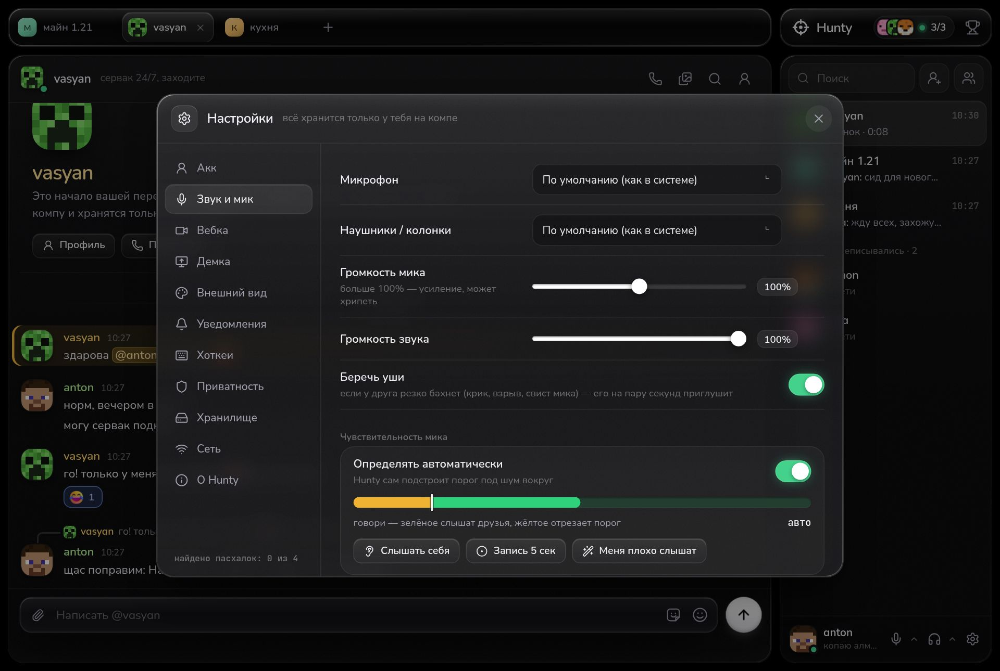

**Внешний вид.** Шрифт и размер текста — под ползунком живой пример, потому что окно настроек закрывает чат. «Пиксели» всегда чёткие.
Обои кладутся под стекло. **Прозрачность стекла** — сколько фона видно сквозь панели, окна и меню: 0 — сплошные, 100 — почти прозрачные.
**Матовость** — насколько размыто то, что под стеклом: 0 — чистое, как витрина. Пока тянешь ползунок, затемнение под окном настроек пропадает — видно, что меняется.
Слабый комп или ноут на батарее — включи «Лёгкий режим» (без стекла, размытия и анимаций): ползунки стекла тогда погашены, панели сплошные.

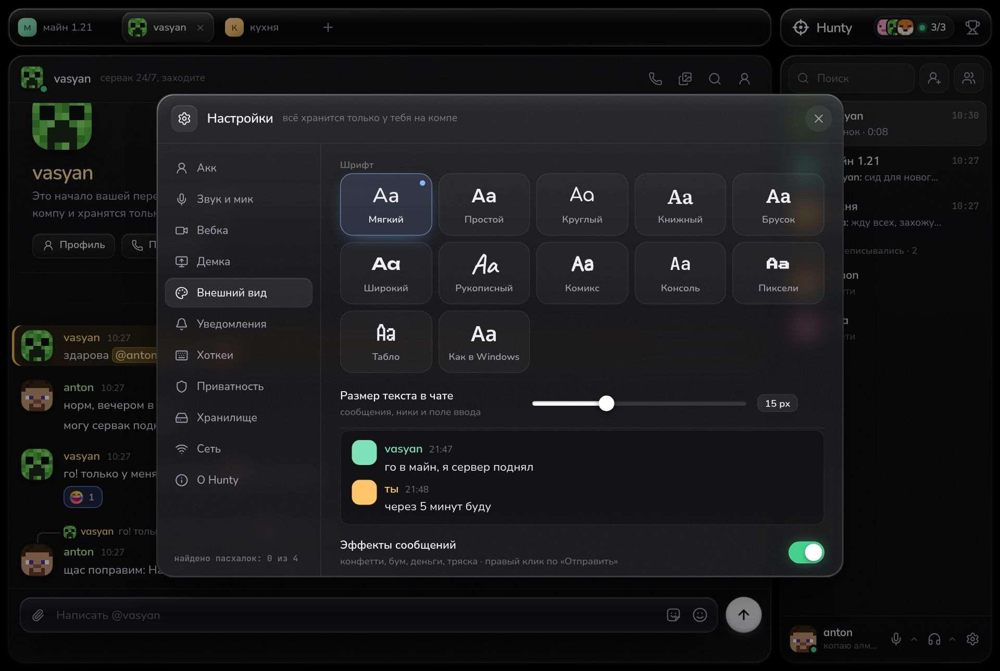

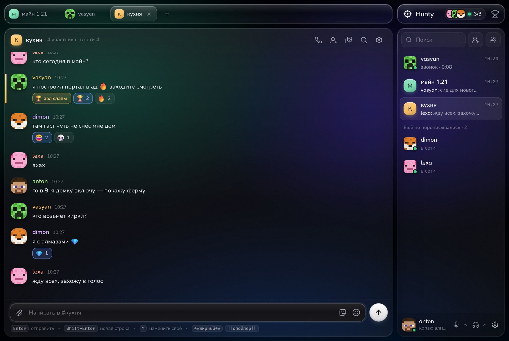

**AFK-мобы.** Пока тебя нет (без мыши, клавы и голоса), мобы приходят по очереди и застраивают экран блоками: Стив носит землю,
житель — руду, слайм — слизь. Кто приходит, через сколько и как быстро — в Настройки → Внешний вид → AFK-мобы.

**Сеть.** Сверху — как дела со связью (кнопка «Проверить»). Ниже — [сервер для друзей](../README.md#сервер-для-друзей), «Помогать друзьям со связью»,
«Открывать порт на роутере» (UPnP), поиск друзей через интернет (IPFS DHT) и постоянный порт. В «Подробнее — для тех, кто шарит» —
порт и свои адреса. **Журнал** — что происходило; «Копировать» — чтобы скинуть разработчику, если что-то сломалось.

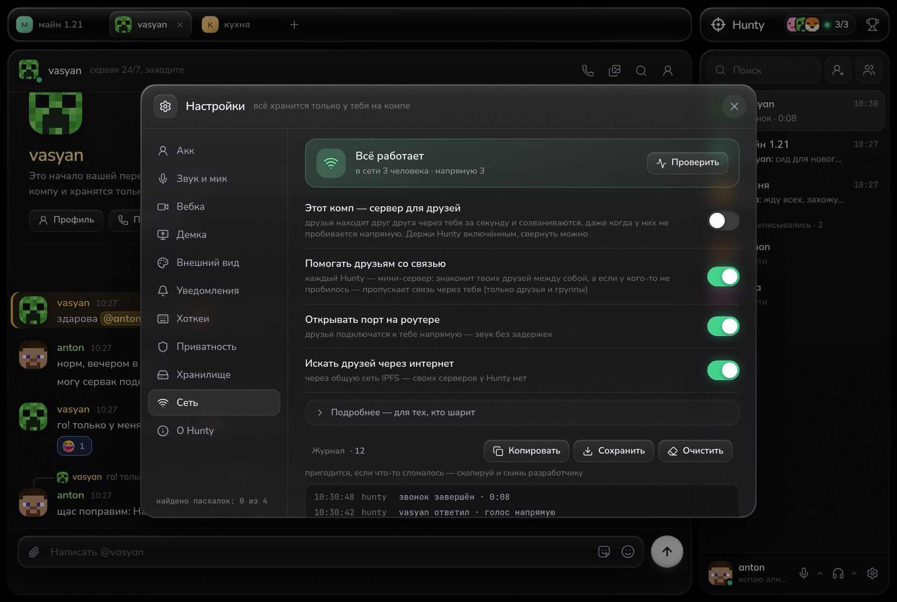

## Трей, обновления, перенос акка

**Трей (Windows).** Крестик прячет Hunty в трей: ты в сети, сообщения и звонки доходят, при звонке окно появится само.
Клик по значку — открыть, правый клик → **Выйти из Hunty** — закрыть совсем. На Linux: Настройки → О Hunty → «Выключить Hunty».

**Обновления.** Раз в день Hunty сам смотрит, не вышла ли новая версия, и пишет «Вышел Hunty vX». На Windows — кнопка **Обновить**:
скачает, перезапустится, история и друзья останутся. На Linux — «Скачать»: распакуй новый архив, сделай `./hunty/hunty --install`, потом «Выключить Hunty» и открой заново.
Вручную — Настройки → О Hunty → «Проверить обновления».

**Перенос акка на другой комп.**

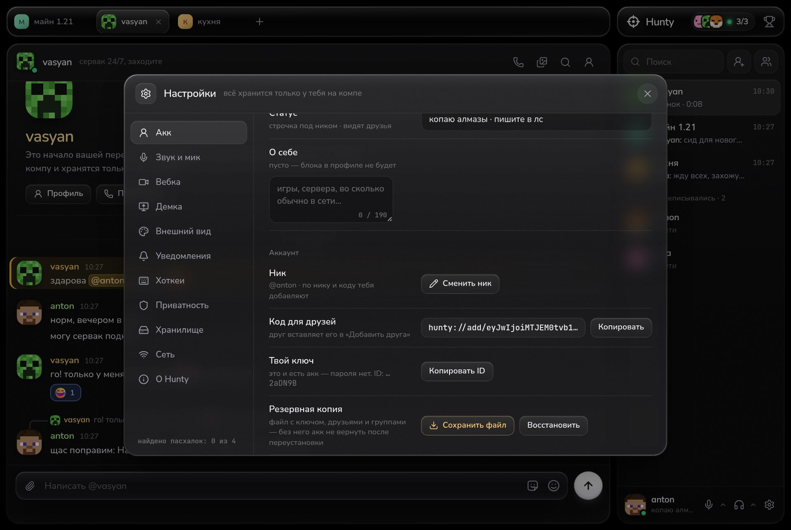

1. На старом компе: Настройки → Акк → Резервная копия → **Сохранить файл**.
2. На новом при первом запуске: **Восстановить из файла** (или Настройки → Акк → «Восстановить»).
3. Ключ, ник, профиль, друзья и группы переедут. Переписка в файл не входит — Hunty докачает её у друзей, когда они будут в сети.

Данные Hunty лежат в `%APPDATA%\app.hunty` (Windows) и `~/.local/share/hunty` (Linux).

## Если что-то не так

Частые проблемы и что с ними делать — в [README → Если что-то не так](../README.md#если-что-то-не-так).
Не помогло — Настройки → Сеть → Журнал → **Копировать** и создай [issue](https://github.com/sklayxxx/hunty/issues) с описанием, что делал.
